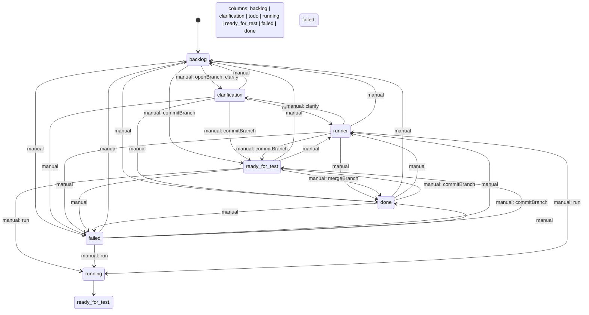

# State machine of the task board

The board's **columns are the task states**: the machine below is what the Host
enforces and what the browser renders. It is declared as plain data in
`src/core/state-machine.ts` (`DEFAULT_STATE_MACHINE`) and can be replaced per
deployment through the plugin config / settings namespace `task-board`, field
`stateMachine`.

A *transition* is an allowed state change together with the **actions** that
fire when it happens (open a feature branch, commit a feature branch, merge a
feature branch, start a run, open the clarification session, stamp a field).
Drag & drop is validated
against exactly these transitions — the browser asks the machine whether a drop is allowed, and the
Host refuses any `move` the machine does not list.



*Regenerate after changing the machine:*

```sh
node scripts/render-state-machine.mjs
```

`tests/state-machine.spec.ts` fails when this diagram no longer matches the
definition.

## Triggers

| Trigger  | Who fires it                                              |
|----------|-----------------------------------------------------------|
| `manual` | A human: drag & drop on the board, or a chip in the task detail. |
| `runner` | The execution runner settling a run (success → `ready_for_test`, failure → `failed`, cancel → `todo`). |
| `cron`   | A scheduled run.                                          |

`running` is the runner's own state: it carries `"drop": false` and only
`runner` transitions leave it. It is *entered* through the `run` action
(`todo → running`), never by a plain status move.

## Clarification column

`backlog → clarification` is the card's **clarification step**, and it runs for
every card — the column is where the agent asks before anything is implemented:

* The transition fires `clarify`, which starts the card's **clarification run**:
  the run column's execution, started through the same launch queue but **not**
  through the lane WIP limit — the clarification column is WIP-free, so the round
  starts right away even while another card of the same workspace is working (no
  **Queued** badge), with the same session link and the same pause/resume
  control. It checks no branch out, because it implements nothing. Its prompt is
  the card's normal run prompt plus the clarification block *"Bitte kläre jetzt
  alle offenen Fragen — und implementiere noch nichts. / Stelle deine Fragen und
  stoppe dann. / Wenn noch Fragen offen sind, stelle die nächsten und stoppe
  wieder. / Wenn du alles geklärt hast stoppe und fasse nur kurz zusammen. / Die
  Implementierung beginnt erst mit «Bitte jetzt implementieren»."*.
* **The questions are the agent's, not a form field.** There is no question list
  on the card: the agent asks what it still needs to know **in the chat** of
  that run, the human answers there, and the agent ends its turn.
* **Stopping is enforced past the first turn.** The board's system-prompt
  section (`TASK_BOARD_GUIDANCE`) carries a clarification-session stop rule that
  keys off the first line of that block and is re-sent with *every* turn: while
  a session is a clarification session, the agent implements nothing — after
  each answer it asks the next question and stops, or stops for good once the
  questions are settled. The wording of the block and the rule cannot drift: the
  rule interpolates the very lines the run sends (`CLARIFICATION_ADDENDUM`). It
  keeps the card in `clarification` — settling the run never changes the column.
* **The human closes the step.** `clarification → todo` is an ordinary manual
  move: the answers are settled, so the card goes on to the column where its
  specification is released. `clarification → backlog` sends it back, and
  `todo → clarification` fires `clarify` again — that re-enters the card's one
  conversation instead of minting a second one.
* The run lands in the card's one conversation (`clarificationSessionId`); the
  run that implements the card continues that same session, so the answers stay
  in context and no second conversation is opened. Passing the step again
  re-enters that conversation.
* A drag straight from `backlog` — or from `clarification` — to `running` has no
  transition at all: the card must pass `todo` first.
* Pulling the card from `todo` on to the run column — or its Run button — is the
  **go-ahead**: it closes the card's open clarification round (recorded as
  cancelled; a round whose launch has not started yet is dropped, and one whose
  session is still being created has that late session stopped instead of
  attached — so the card owns exactly one open execution and one conversation)
  and continues that conversation with *"Bitte jetzt implementieren."*. The
  implementation run itself is an ordinary run and still obeys the lane's WIP
  limit — and it is gated by the released specification.
* A **group drop** (`move-many`) never opens executions: a batch onto a
  transition that carries `run` *or* `clarify` is refused, so a batch can never
  start runs and never park a card in the clarification column without its
  round.

## Actions attached to transitions

| Action              | Effect                                                                 |
|---------------------|------------------------------------------------------------------------|
| `git.openBranch`    | Cuts the card's feature branch (`task/<slug>-<id8>`) from the base branch **and its own worktree** under `$DSH_HOME/task-board/worktrees/<id>`: the run session is created on that directory, so the main checkout keeps the branch the human left it on. A branch that already exists is re-attached; where `git worktree` refuses, the historical shared checkout is used instead. No-op without a git repository. |
| `git.commitBranch`  | Commits the worktree onto the card's feature branch (`committedAt` stamp) and stamps the resulting head as `reviewedCommit` — the commit the review column shows, cutting the branch first when the card has none. No-op without a repository or when the worktree is clean — never an empty commit. |
| `git.mergeBranch`   | Replays the feature branch onto its base branch as that stands now (`git rebase` — other cards may have merged meanwhile) and merges it back — but **only** the commit the card was parked on: a card without a recorded review commit, a dirty worktree, or a branch that moved past that commit is refused before anything is replayed. On the release into `done` this is the merge release: a refusal or a failure parks the card in `failed` with the reason, and a **conflict** in the replay is resolved by the card's own agent instead (see *Merge release*). |
| `run`               | Opens an execution for the card and moves it to the transition target (drag onto "In progress"). A human start releases the clarification gate and continues the card's clarification session; only cron refuses an unresolved card. **Every** `run` (this move, the detail Run button, `rerun`, cron) is refused while the card has no released specification (see *Specification release*). |
| `clarify`           | Opens the card's clarification run: the same execution as `run` (same queue, but WIP-free — the clarification column starts without waiting for a lane slot), its prompt asks the agent's open questions in the card's chat and stops, it checks no branch out, and settling it leaves the card in its column. |
| `{ kind: "stamp", field: "doneAt" }` | Writes a timestamp into a task field.                    |

In the shipped machine the git actions describe the agentic-programming flow:
`backlog → clarification` opens the branch, every way into `ready_for_test` commits it
(`backlog →`, `todo →`, `done →` and `failed → ready_for_test` all carry
`git.commitBranch`), and `ready_for_test → done` merges it back. A branch or
merge hook that refuses fails the move, so a card never claims a branch or a
merge that did not happen; the commit hook is the deliberate exception — it
records its failure on the card (below) instead of blocking the park, because
uncommitted work must not keep a card out of the review column. The `run` action
sits on the way into `running`: `todo → running` starts the card, and
`ready_for_test → running` / `failed → running` pull a reviewed or failed card
straight back onto the run column (the run continues the card's conversation, so
a correction written there is already in context). `clarify`
rides the same `backlog → clarification` transition as the branch hook — the
card's clarification step.

## Commit policy: nothing stays uncommitted

Work on a card happens on its **feature branch**, and the worktree is never left
holding uncommitted card work:

* The branch is cut when the card enters `clarification` (and at run start when
  a cron trigger or the Run button skipped that step). The card gets its **own
  worktree** there, and the run's session is created in it (`cwd`), so the main
  checkout is never used as the card's workspace: a clarification round of
  another card of the same workspace cannot yank a working run's directory, and
  the human's checkout keeps its branch and its uncommitted state. Everything
  below happens in that worktree; only the merge runs in the main checkout.
* A card whose worktree is gone (removed by hand, or merged earlier) falls back
  to the main checkout and checks the branch out there, exactly like a card from
  before this feature.
* **A run settles into `ready_for_test` only once its session has ended**: the
  runner reports `succeeded` after the newest `turn/end` solely when a fresh
  roster read no longer lists the session as running and its live inbox and jobs
  are quiet. An agent writing `FERTIG: <summary>` in its answer reports the work
  for the human; it does not move the card while the session is still running.
* Reaching **`ready_for_test` commits**: the `git.commitBranch` action covers
  every manual move into the column, and the runner's own settle
  (`running → ready_for_test`) commits through the same git helper, because a
  settle fires no configurable action. `git add -A` takes the whole worktree and
  commits it as `task: <title>`; a clean worktree produces no commit and leaves
  the previous `committedAt` in place.
* **Every settle commits, not only a successful one**: a failed run and a
  cancelled run (including the Host cancelling an interrupted start at restart)
  commit their work too, so nothing is left behind in any outcome. A
  clarification run implements nothing and checks no branch out — it never
  commits. A paused run is not settled and therefore commits nothing until it is
  resumed and settles.
* A commit that git refuses (a rejecting hook, say) **does not fail the move or
  the settle**: the error is appended to the newest execution's `error`, which
  the card's execution history in the detail view shows. A card that never ran
  has no execution to carry it and only gets a Host warning.
* The replay onto the base and the final merge happen in the **main checkout**
  (a worktree never has the base branch checked out) — except the replay's own
  conflict, which is resolved in the card's worktree — and the merged card's
  worktree is removed afterwards — the branch, the commits and the review stamp
  all live on in the repository. A worktree git refuses to remove (untracked
  build artifacts) is left alone and never fails the accept.
* **Deleting** a card releases its worktree too: nothing else points at the
  directory. Archiving does not — a restored card has to find its checkout
  again (and falls back to the main checkout when it is gone).
* The card's `TaskGit` records `committedAt` (the instant of the last commit, not
  shown in the UI) next to `mergedAt`.

## Specification release: the gate in front of every run

A card is implemented only after a human released its specification. The release
is one ledger stamp, `TaskRecord.specApprovedAt`, written by exactly one action —
`approve-spec` (the *Release specification* button in the card detail) — and
checked by the Host on **every** `run` path:

* the `run` transition (a drop onto the run column),
* the detail view's Run button (`run`/`rerun`),
* cron (`openScheduled`): an unreleased card is not started unattended; the
  occurrence is skipped and the schedule rolls to the next one, exactly like the
  permission gate.

The refusal is a Host error, so no browser path can bypass it: manual runs throw
`spec-approval-required`, cron skips silently and advances the schedule. A
clarification run (`clarify`) is *not* gated — asking the questions is what
happens before the release.

The gate re-arms when the released text changes: editing the content (title,
description, prompt) or the parse source clears the stamp, so a card whose
instruction changed is never implemented on the old approval. The same holds for
an imported card: the wire sanitizer whitelists an imported card's fields, so a
release never travels with it.

## Review gate: the approval is bound to one commit

Reaching `ready_for_test` does not only commit — it stamps the commit the branch
now stands on as the card's `reviewedCommit`. That is the state a human reviews,
and `git.mergeBranch` (the way into `done`) takes **exactly** it:

* The branch head must still equal `reviewedCommit`, and the worktree must be
  clean. A commit or an edit that lands after the park makes the approval stale:
  the release is refused, the card stays in `ready_for_test`, and nothing lands on
  the base branch. Committing the leftover as a "safety net" is deliberately
  gone — that is precisely the unreviewed work the gate exists to stop.
* The gate is checked *before* the branch is replayed onto the base (see *Merge
  release*): what goes onto the base is the commit the human saw, never one a
  replay already rewrote.
* Re-parking the card rebinds the approval: every route back into
  `ready_for_test` (`git.commitBranch` on the manual moves, and the runner's own
  settle) stamps the new head. The ordinary way to review new work is therefore
  `ready_for_test → todo` (the rework return), correction in the card's chat,
  the next run, and the next park.
* A card **without** a `reviewedCommit` is refused too (fail closed): cards
  parked before this gate existed, and cards a custom machine routes into
  `ready_for_test` without `git.commitBranch`. Moving such a card out of the
  review column and back in stamps the commit; a custom machine should carry
  `git.commitBranch` on every way into `ready_for_test` (it already should, for
  the commit policy above).
* The refusal is recorded on the card and the card goes to `failed` (see *Merge
  release*), so the reason stays readable until the card is sent back and
  re-released.

`reviewedCommit` is only a bind — the commit that reaches `done`, is the one the
human saw in the review column, replayed onto the base as it stood at the
release.

## Merge release: how a card reaches `done`

`ready_for_test → done` is not a status move that happens to run git: it is the
card's **merge release**, and both ways of asking for it — dragging the card on
to Done and the *Release for merge* button in the card's review block (`approve-merge`
Host action) — go through the same Host routine, so the two can never disagree.

* **No branch, nothing to merge.** A card whose workspace has no repository (or
  a workspace outside git, without a `repoSubpath` entry — see below) is released
  like before: it moves to `done`, and the release is recorded as skipped
  (`TaskMerge.skipped`) so the card says "no branch" instead of pretending it
  merged something.
* **The branch is replayed onto the base first.** This card was cut from the
  base when it was pulled in, and other cards may have merged into that base
  since. The release therefore runs `git rebase <base>` in the card's own
  directory before it merges anything: the reviewed commit ends up *on top of*
  the base as it stands now. Without that step the reviewed work would meet the
  current base only inside the final merge commit — a clean text merge that
  nobody ever built or ran against the new base. A branch that already lies on
  the base is untouched (the replay is then a no-op).
* **The merge succeeds.** The feature branch lands on the base branch
  (`--no-ff`), the card moves to `done`, and both `TaskGit.mergedAt` and
  `TaskMerge.mergedAt` name the instant. The disposable worktree is removed; the
  branch, the commits and the review stamp survive in the repository.
* **The release is refused or fails** (dirty worktree, a branch past the reviewed
  commit, no reviewed commit, git's own error): the card goes to `failed` with
  the Host's reason on its `merge` record. From there the ordinary rework path
  applies — the human writes the correction into the card's chat, the card
  returns to `todo`, the next park rebinds the approval and clears the release
  record, and the next release tries again.
* **The replay conflicts.** The half-done rebase **stays in the card's own
  worktree**, markers and all, and is never handed to the human's checkout: the
  card moves to `running` on a `merge` execution whose turn is the merge framing
  (resolve the conflict, `git add`, `git -c core.editor=true rebase --continue`,
  change nothing else). That resolution is part of the release the human asked
  for, so the run's settle commits it (the commit hook never commits an
  unfinished replay) and re-stamps `reviewedCommit` to the replayed head.
* **One attempt.** A release starts at most one resolution run
  (`MERGE_RESOLVE_ATTEMPTS`). When it settles `succeeded` and the replay is
  finished, the Host retries the release by itself: success parks the card in
  `done`, and a second conflict (or a run that failed, was cancelled, or
  "succeeded" without finishing the replay — unmerged files and an unfinished
  rebase are checked, never trusted) parks the card in `failed` with the reason.
  A failed or refused resolution aborts the unfinished rebase, which puts the
  branch back onto `reviewedCommit`, so neither the next run nor a later release
  starts on top of a half-done replay.
* **Visible on the card.** The card's merge state is derived
  (`core/merge.ts`): `merged`, `unmerged`, `released`, `resolving`, `failed` or
  `no-branch`. The card carries it as a badge, and the review block names the
  released commit, the release instant, the conflict and the error. A card whose
  release failed keeps that merge section — the reason is what the correction is
  written about — while the column's controls (release, start/stop) are gone with
  the column.
* **Group drops stay strict.** `move-many` never starts runs (nor resolution
  runs), so a batch onto Done keeps the plain merge hook: a card that cannot be
  merged aborts the whole drop and nothing moves. The release with its automatic
  resolution is the single-card path.


## Repository discovery: `repoSubpath`

The git flow needs the repository root: it cuts the card's branch there, creates
the card's worktree there and merges back there. A workspace whose directory is a
container folder (`app/`, `infra/`, docs) is therefore not a repository itself,
and its cards would silently have no branch at all.

The setting `repoSubpath` names the repository per workspace:

```json
[{ "path": "/home/me/proj", "repo": "app" }]
```

`repo` is relative to `path` (or an absolute directory of its own), the longest
matching `path` wins, and the document is validated by the same parser the Host
executes (`core/repo-config.ts`). The repository it names is what the card's
`TaskGit.repoPath` becomes — so the branch, the worktree, the commit on the park
and the merge all work exactly as they do for a workspace that *is* a repository
— and the review block falls back to it for a card that has no git state at all.
An entry that names a directory that is not a repository changes nothing: the
card keeps working without a branch.

## Rework: back to `todo` from the review

A card that did not pass the review (or whose run failed) goes back to `todo`
when the human writes the correction into the card's **own conversation**: the
Host watches those chats, fires the ordinary `ready_for_test → todo` (or
`failed → todo`) move on that human turn, and stamps the card (`reworkAt`,
`reworkCount`). No note text is stored anywhere — the transcript *is* the note,
and the send-back never starts a run. The card's next run is marked as the
rework round, continues the corrected conversation, and opens with a short
framing turn instead of the card body (see the README section *Write the
correction into the card's chat*).

## Task environments (Docker Compose)

A card whose worktree carries a compose file gets **its own stack**, so the
agent's work runs against a real application without touching the human's own
containers:

* **Discovery, not configuration**: the board looks for the configured file
  (`composeFile`, default `docker-compose.yml`) in the card's worktree and falls
  back to `compose.yaml` / `docker-compose.yaml`. No file means no environment —
  that is the normal case, not an error. An empty `composeFile` turns the
  feature off entirely.
* **Task-scoped project**: every command runs with `-p dsh-tb-<id8>` and
  `COMPOSE_PROJECT_NAME`, in the card's worktree, so containers, networks and
  volumes belong to that card alone. The card id also travels in the environment
  as `DSH_TASK_ID`, so a compose file can key its own variables on it.
* **Lifecycle**: `docker compose up -d` runs **before the implementation run
  gets its prompt** (a clarification round needs no environment), and the
  published host ports are read back with `docker compose ps --format json` and
  recorded on the card. The stack stays while the card is in `running` or
  `ready_for_test` — the human tests against it — and is stopped with
  `docker compose down -v --remove-orphans` as soon as the card leaves those
  columns, is archived, is deleted, or has vanished from the ledger. A Host
  restart keeps the stacks (their record is in the ledger) and continues to
  reconcile them.
* **Fail closed**: a configured environment that does not come up fails the run
  before any agent work starts, with docker's own output appended to the run's
  `error` and kept on the card (`TaskCompose.error`). Implementing against an
  environment that never started would be worse than not starting.
* **Ports**: the board never rewrites the compose file's port mappings. What it
  does is hand the stack an environment of its own (`composeEnv`, `KEY=VALUE`
  pairs): `{port}`, `{port2}` … `{port9}` become distinct free host ports picked
  for that card (probed on the loopback interface and **remembered on the card**,
  so a re-run re-creates the stack on the ports the human already knows) and
  `{task}` the card id. A compose file that publishes variable ports —
  `ports: ["${PORT:-8092}:${PORT:-8092}"]`, or three of them for app, devtools
  and VNC — therefore gets its own ports per card instead of colliding with the
  stack the human runs themselves; `composeEnv: PORT={port}` (or
  `JOBSUCHE_PORT={port},JOBSUCHE_CDP_PORT={port2}`) is the whole configuration. A
  file with hard-coded ports still collides, and compose says so on the card.
* Two things a compose file has to do itself, because the board must not rewrite
  it: a **fixed `container_name:`** collides with the human's own container (use
  a variable, as the fork's own examples do), and a **named volume** is
  per-project, so a task stack starts with an empty database — which is the
  isolation the feature is for, and `down -v` removes it again.
* The card's environment is also **announced in the run prompt** (project name
  and published ports), so the agent works against that stack with
  `docker compose -p <project> ...` instead of starting a second one under the
  default project name.

## Configuration

```jsonc
{
  "initial": "backlog",
  "states": [
    { "status": "backlog" },
    { "status": "clarification" },
    { "status": "todo" },
    { "status": "running", "drop": false },
    { "status": "ready_for_test", "label": "Review" },
    { "status": "done" },
    { "status": "failed", "order": 9 }
  ],
  "transitions": [
    { "from": "backlog", "to": "clarification", "actions": ["git.openBranch", "clarify"] },
    { "from": "clarification", "to": "todo" },
    { "from": "todo", "to": "running", "actions": ["run"] },
    { "from": "todo", "to": "ready_for_test", "actions": ["git.commitBranch"] },
    { "from": "ready_for_test", "to": "done", "actions": ["git.mergeBranch"] }
  ]
}
```

* `states[].status` — one of `backlog`, `clarification`, `todo`, `running`,
  `ready_for_test`, `done`, `failed` (the ledger's closed vocabulary). `label` overrides the
  column title, `order` moves the column, `drop: false` makes it a column that
  never accepts a card.
* `transitions[]` — `from`/`to` plus optional `trigger`, `actions`, `git`
  (`false` skips the git hooks of that transition). Anything not listed is
  refused. A custom machine should put `git.commitBranch` on its own ways into
  `ready_for_test`: stored configurations are left as they are, and only the
  runner's settle commits independently of the configured transitions.
* `initial` — where new cards land; required when `backlog` is not a column.

Task environments are not part of the machine: the stack is tied to the *run*
(not to a transition), because it has to exist before the session starts and
because a compose file is a property of the workspace, not of a state change.

Invalid configuration never bricks the board: the normalizer refuses the whole
document with reasons, the machine in force stays, and the settings card marks
the field invalid. The Host hands its resolved machine to the browser inside
the snapshot, so both halves always validate against the same transitions.
